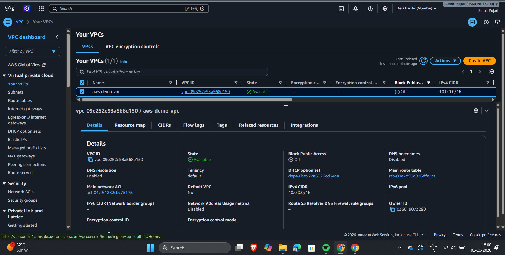
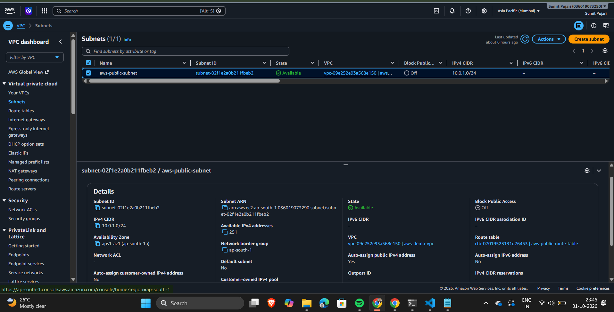
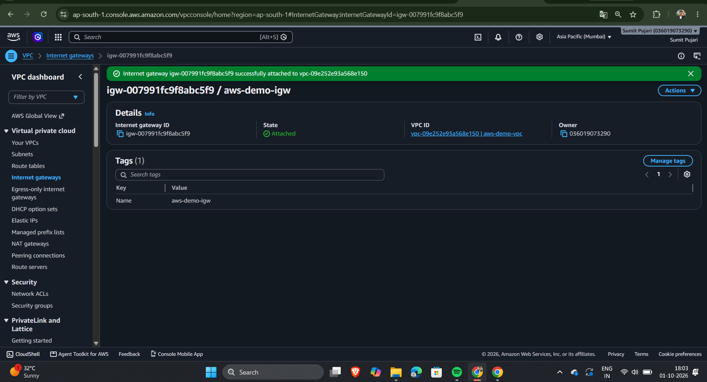
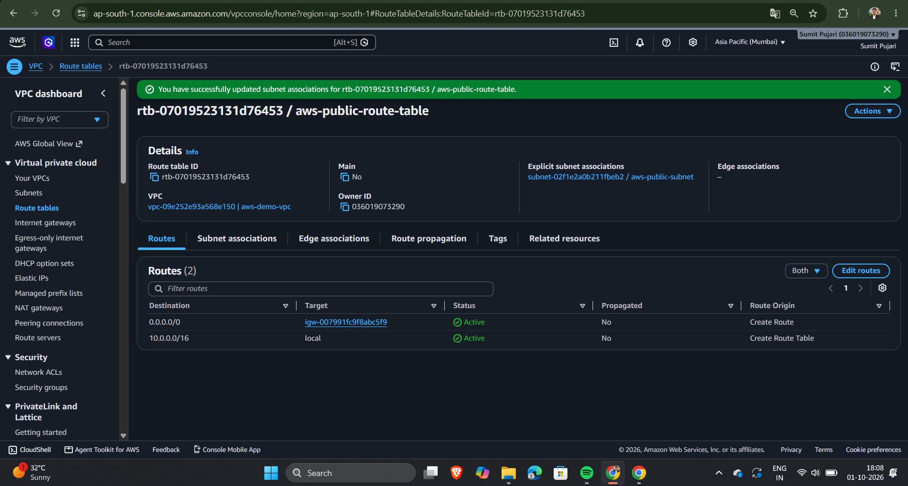
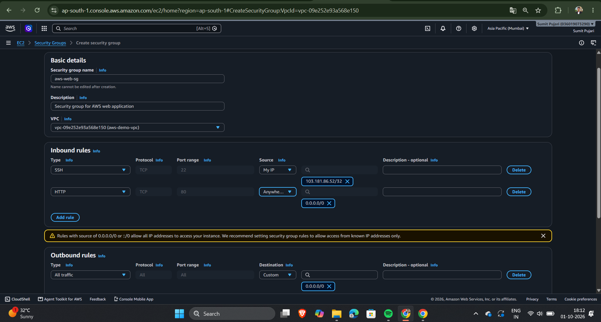
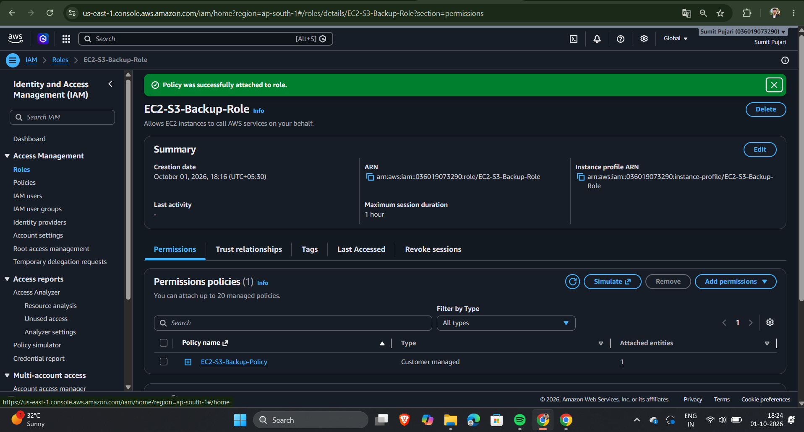
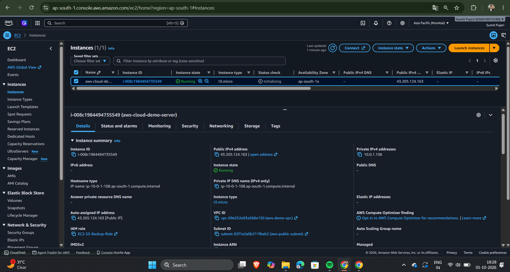
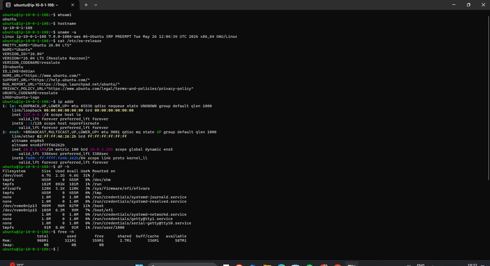
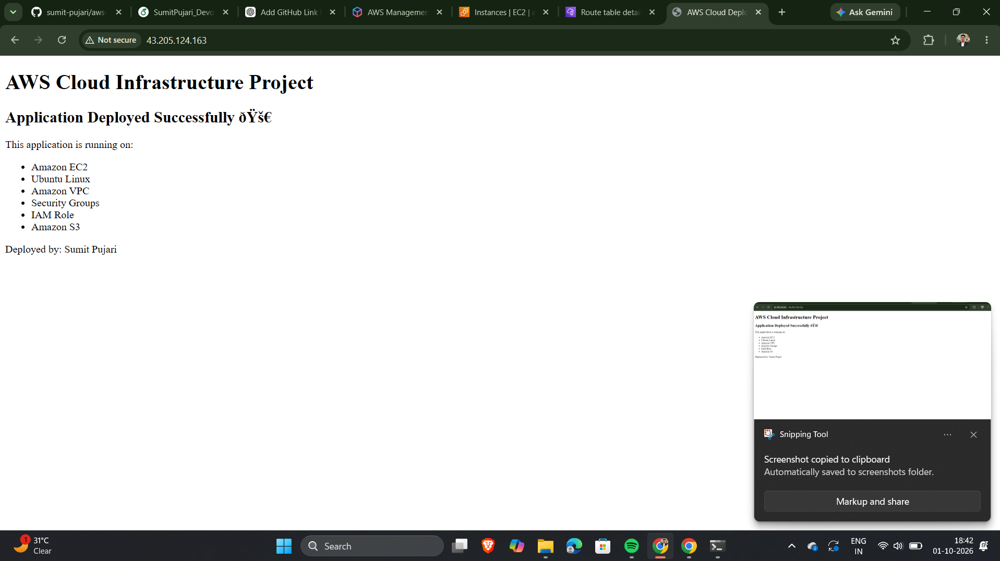
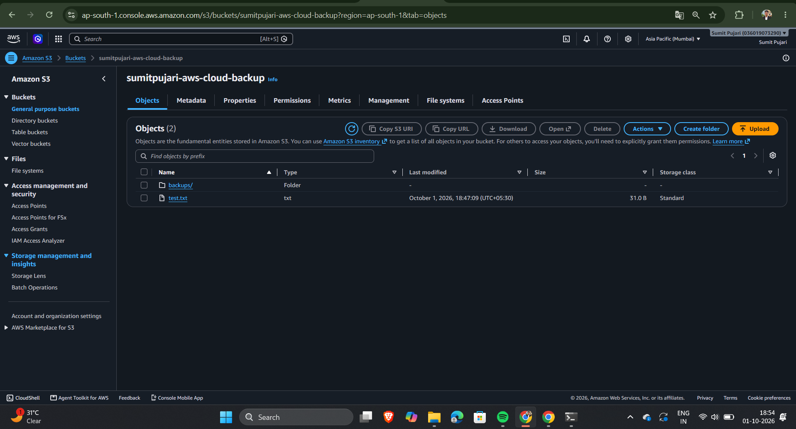

# ☁️ AWS Cloud Infrastructure and Application Deployment

> A hands-on AWS cloud infrastructure project demonstrating how to design, provision, secure, and deploy a Linux-based web application using Amazon VPC, EC2, IAM, Security Groups, and Amazon S3.

---

## 📌 Project Overview

This project demonstrates the complete process of deploying a sample web application on AWS using core cloud infrastructure services.

The infrastructure was manually configured to understand how different AWS services work together to provide:

- Network connectivity
- Secure server access
- Application hosting
- Identity and access management
- Object storage
- Application backup
- Basic cloud security

The application is hosted on an Ubuntu-based Amazon EC2 instance and served using Nginx.

Amazon S3 is integrated with the EC2 instance using an IAM role to store application backups without storing AWS credentials directly on the server.

---

# 🎯 Project Objectives

The main objectives of this project are:

- Understand AWS VPC networking fundamentals
- Create and configure a custom VPC
- Create a public subnet
- Configure an Internet Gateway
- Configure route tables
- Configure Security Groups
- Provision a Linux-based EC2 instance
- Configure secure SSH access
- Deploy a sample web application
- Configure Nginx as a web server
- Create an IAM role for EC2
- Integrate EC2 with Amazon S3
- Store application backups in S3
- Verify the complete deployment
- Document the infrastructure and deployment process

---

# 🏗️ Architecture

The project follows the architecture below:

```text
                           INTERNET
                              │
                              ▼
                    ┌──────────────────┐
                    │ Internet Gateway │
                    └────────┬─────────┘
                             │
                             ▼
                 ┌────────────────────────┐
                 │       AWS VPC          │
                 │      10.0.0.0/16       │
                 │                        │
                 │  ┌──────────────────┐  │
                 │  │  Public Subnet   │  │
                 │  │  10.0.1.0/24     │  │
                 │  │                  │  │
                 │  │ ┌──────────────┐ │  │
                 │  │ │     EC2      │ │  │
                 │  │ │ Ubuntu Linux │ │  │
                 │  │ │    Nginx     │ │  │
                 │  │ └──────┬───────┘ │  │
                 │  └─────────┼────────┘  │
                 │            │           │
                 └────────────┼───────────┘
                              │
                         IAM Role
                              │
                              ▼
                     ┌────────────────┐
                     │   Amazon S3    │
                     │    Backups     │
                     └────────────────┘
```

# Architecture Flow
```
Internet
   ↓
Internet Gateway
   ↓
Route Table
   ↓
Public Subnet
   ↓
Security Group
   ↓
EC2 Instance
   ↓
Nginx Web Server
   ↓
Web Application

EC2
   ↓
IAM Role
   ↓
Amazon S3
   ↓
Application Backup
```

# 🛠️ Technologies and AWS Services
| Technology / Service | Purpose                                   |
| -------------------- | ----------------------------------------- |
| Amazon EC2           | Application server                        |
| Amazon VPC           | Isolated cloud network                    |
| Subnet               | Network segmentation                      |
| Internet Gateway     | Internet connectivity                     |
| Route Table          | Network traffic routing                   |
| Security Group       | Instance-level firewall                   |
| IAM                  | Identity and access management            |
| Amazon S3            | Backup and object storage                 |
| Ubuntu Linux         | Server operating system                   |
| Nginx                | Web server                                |
| Bash                 | Server automation                         |
| SSH                  | Secure server access                      |
| Git / GitHub         | Project documentation and version control |

---

# 🌐 Network Architecture
## 1. VPC

A custom VPC was created for the project.

### Configuration
```
VPC Name: aws-demo-vpc-vpc
CIDR Block: 10.0.0.0/16
Region: Asia Pacific (Mumbai)
Region Code: ap-south-1
```
The CIDR block provides a private IP address range for resources inside the VPC.



---
## 2. Public Subnet

A public subnet was created inside the VPC.
```
Subnet Name: aws-public-subnet
CIDR Block: 10.0.1.0/24
Availability Zone: ap-south-1a
```
The subnet is configured to automatically assign public IPv4 addresses to resources launched inside it.

Network Structure
```
VPC
10.0.0.0/16
     │
     └── Public Subnet
         10.0.1.0/24
```


---
## 3. Internet Gateway

An Internet Gateway was created and attached to the custom VPC.
```
Internet Gateway:
aws-demo-igw
```
The Internet Gateway provides a path between the VPC and the public Internet.
```
Internet
    │
    ▼
Internet Gateway
    │
    ▼
VPC
```


---
## 4. Route Table

A public route table was created and associated with the public subnet.
```
Route Table:
aws-public-route-table
```
The following route was configured:
```
Destination: 0.0.0.0/0
Target: Internet Gateway
```
This allows traffic from the public subnet to reach the Internet through the Internet Gateway.

### Routing Flow
```
EC2
 ↓
Public Subnet
 ↓
Route Table
 ↓
0.0.0.0/0
 ↓
Internet Gateway
 ↓
Internet
```


---

# 🔐 Security Configuration
## 5. Security Group

A Security Group was created for the EC2 instance.
```
Security Group:
aws-web-sg
```
### Inbound Rules
| Type | Protocol | Port | Source    | Purpose               |
| ---- | -------- | ---: | --------- | --------------------- |
| SSH  | TCP      |   22 | My IP     | Secure administration |
| HTTP | TCP      |   80 | 0.0.0.0/0 | Web application       |

### Outbound Rules

The instance is allowed to make outbound connections as required.

### Security Concept

SSH access is restricted to the administrator's IP address instead of exposing port 22 to the entire Internet.

HTTP port 80 is publicly accessible because the application needs to be reachable through a web browser.



---
# 👤 IAM Configuration
## 6. IAM Role

An IAM role was created for the EC2 instance.
```
Role Name:
EC2-S3-Backup-Role
```
The role allows the EC2 instance to interact with the project's S3 bucket without storing AWS access keys on the server.

IAM Policy

A custom policy was created following the principle of least privilege.

The EC2 instance requires permissions such as:
```
s3:ListBucket
s3:GetObject
s3:PutObject
s3:DeleteObject
```
The permissions are restricted to the project's S3 bucket.

### Why IAM Role?

Instead of doing:
```
EC2
 ↓
AWS Access Key
 ↓
S3
```
the project uses:
```
EC2
 ↓
IAM Role
 ↓
S3
```
This avoids storing long-term AWS credentials on the server.



---

# 💻 EC2 Infrastructure
## 7. EC2 Instance

A Linux-based EC2 instance was provisioned inside the custom VPC.

### Configuration
```
Instance Name:
aws-cloud-demo-server

Operating System:
Ubuntu Server

Region:
ap-south-1

VPC:
aws-demo-vpc-vpc

Subnet:
aws-public-subnet

Security Group:
aws-web-sg

IAM Role:
EC2-S3-Backup-Role

```
The instance was configured with a public IPv4 address to allow administrative SSH access and public web traffic.



---

# 🔑 EC2 Secure Access

The EC2 instance was accessed using SSH.

Example:
```
ssh -i "aws-cloud-demo-key.pem" ubuntu@<EC2_PUBLIC_IP>
```
The private key was kept locally and was not uploaded to GitHub.

---
# 🐧 Linux Server Configuration

After connecting to the server, the operating system was updated.
```
sudo apt update
sudo apt upgrade -y
```
Basic system information was verified using:
```
whoami
hostname
uname -a
cat /etc/os-release
df -h
free -h
```
These commands were used to verify the server environment and available resources.


---
# 🌐 Application Deployment
## 8. Installing Nginx

Nginx was selected as the web server for the sample application.

Installation:
```
sudo apt update
sudo apt install nginx -y
```
Check the service:
```
sudo systemctl status nginx
```
The expected status is:
```
Active: active (running)
```
Enable Nginx to start automatically:
```
sudo systemctl enable nginx
```
---
# 🧪 Application Testing

The application was first tested locally from the EC2 instance.
```
curl http://localhost
```
The server returned the application HTML successfully.

The Nginx listening port was also verified:
```
sudo ss -lntp
```
HTTP response headers were checked using:
```
curl -I http://localhost
```
Expected response:
```
HTTP/1.1 200 OK
```
---
# 🌍 Public Application Access

The application can be accessed through the EC2 public IPv4 address:
```
http://<EC2_PUBLIC_IP>
```

### Application Result

The deployed application displays:
```
AWS Cloud Infrastructure Project

Application Deployed Successfully 🚀
```


---

# 🪣 Amazon S3 Integration
## 9. S3 Bucket

An Amazon S3 bucket was created to store application backups.
```
Bucket Name:
<YOUR_BUCKET_NAME>

Region:
ap-south-1
```
S3 Block Public Access remains enabled.

The bucket is accessed by the EC2 instance through the IAM role.




---
# 🔄 EC2 to S3 Integration

The AWS CLI was configured on the EC2 instance.

The identity associated with the EC2 instance was verified:
```
aws sts get-caller-identity
```
The command confirms that AWS API requests are being made through the attached IAM role.

---
# 📦 S3 Upload Test

A test file was created:
```
echo "AWS EC2 to S3 integration test" > test.txt
```
The file was uploaded to S3:
```
aws s3 cp test.txt s3://<YOUR_BUCKET_NAME>/
```
The bucket contents were verified:
```
aws s3 ls s3://<YOUR_BUCKET_NAME>/
```
Expected result:
```
test.txt
```


---
## 💾 Application Backup

An application backup was created from the EC2 instance.
```
sudo tar -czf /tmp/nginx-backup.tar.gz /var/www/html
```
The backup was uploaded to S3:
```
aws s3 cp /tmp/nginx-backup.tar.gz \
s3://<YOUR_BUCKET_NAME>/backups/
```
The backup was verified:
```
aws s3 ls s3://<YOUR_BUCKET_NAME>/backups/
```
The resulting architecture is:
```
EC2
 │
 │ Application Files
 ▼
Backup Archive
 │
 │ aws s3 cp
 ▼
Amazon S3
 │
 └── backups/
       └── nginx-backup.tar.gz
```
---
# 🔁 Backup Restoration Test

The backup was also downloaded from S3 to verify that stored objects could be retrieved.
```
mkdir ~/restore-test
```
Download:
```
aws s3 cp \
s3://<YOUR_BUCKET_NAME>/backups/nginx-backup.tar.gz \
~/restore-test/
```
Verify:
```
ls -lh ~/restore-test/
```
This validates both:
```
EC2 → S3
S3 → EC2
```

```

This validates both:

EC2 → S3
S3 → EC2
